  

  Je conçois des interfaces dans Figma, puis je les code. 
  Entre les deux, un peu de 3D, de VR et de motion design.

  
  

 

  

### En ce moment

- **Bloons VR** : tower defense en VR sous Unity pour Meta Quest 3, en équipe (SAÉ 501). Je m'occupe de l'économie, des bonus de gameplay, du casino et du son
- **Blockchain 3D** : visualisation pédagogique de la blockchain dans le navigateur, côté design et UX
- **Budget à deux** : PWA de budget partagé, en Next.js et Supabase

 

<h3 align="center">Statistiques</h3>

  

<!-- banner.svg et skills.svg : python src/build.py -->
