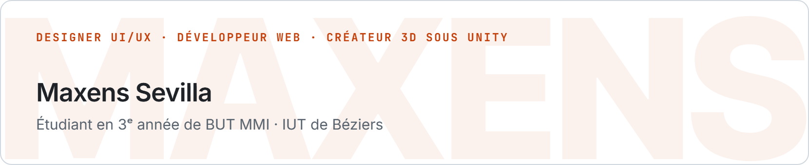
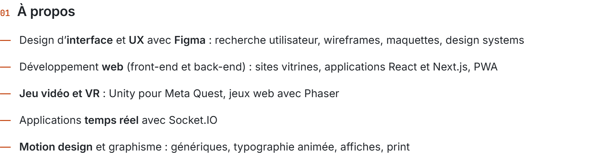

<picture><source media="(prefers-color-scheme: dark)" srcset="assets/dark/banner.png"></picture>

  

<picture><source media="(prefers-color-scheme: dark)" srcset="assets/dark/apropos.png"></picture>

  

<picture><source media="(prefers-color-scheme: dark)" srcset="assets/dark/techno.png"></picture>

  

<picture><source media="(prefers-color-scheme: dark)" srcset="assets/dark/stats.png"></picture>

 

<picture><source media="(prefers-color-scheme: dark)" srcset="https://streak-stats.demolab.com?user=MaxX-J&locale=fr&disable_animations=true&border_radius=12&background=00000000&border=30363D&stroke=30363D&ring=FF8A3D&fire=FF8A3D&currStreakNum=E6EDF3&sideNums=E6EDF3&currStreakLabel=FF8A3D&sideLabels=8B949E&dates=8B949E"></picture>

<!-- Visuels générés par banner-src/render.py (source : banner-src/sobre.html) -->
